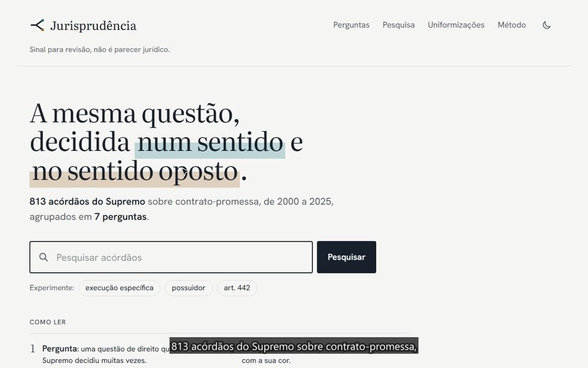
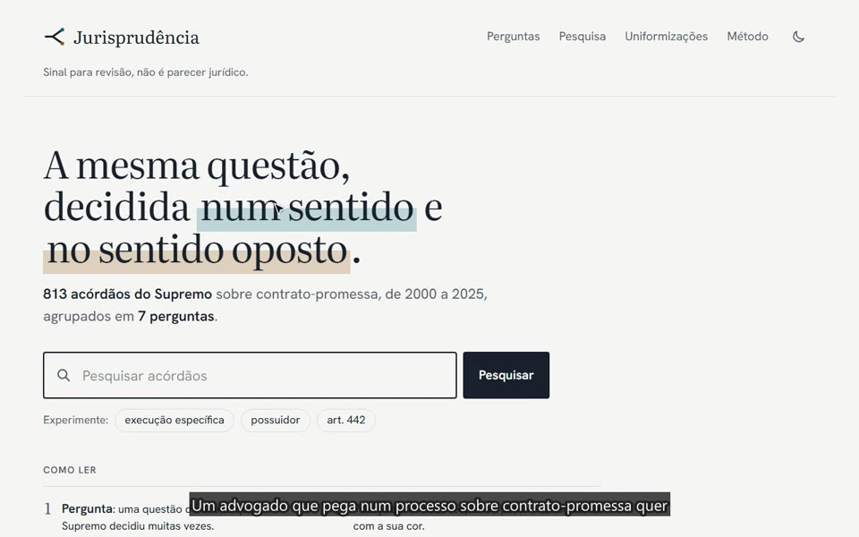

# Jurisprudência

Agrupa acórdãos do Supremo Tribunal de Justiça (STJ), publicados no [dgsi.pt](https://www.dgsi.pt), por **questão jurídica** e mostra **onde e quando a jurisprudência divergiu ou mudou**. Cada sinal traz uma citação literal do acórdão e a ligação ao original.

> **Aviso:** sinal para revisão, não é parecer jurídico.

**Sítio:** https://carolinanunesmartins.github.io/jurisprudencia/
**Ler primeiro:** [NOTA.md](NOTA.md) (uma página) · [IA.md](IA.md) (uso de IA) · [relatório de avaliação](data/eval/report.md)

## Vídeos

Clique numa imagem para ver o vídeo no browser (também no telemóvel).

<table>
  <tr>
    <td align="center"><a href="https://carolinanunesmartins.github.io/jurisprudencia/video/anuncio.mp4"></a><br><b><a href="https://carolinanunesmartins.github.io/jurisprudencia/video/anuncio.mp4">Anúncio</a></b><br>45 s · a ideia em cinco frases</td>
    <td align="center"><a href="https://carolinanunesmartins.github.io/jurisprudencia/video/demo-60s.mp4"></a><br><b><a href="https://carolinanunesmartins.github.io/jurisprudencia/video/demo-60s.mp4">Demonstração curta</a></b><br>41 s · um exemplo, o gráfico e o método</td>
    <td align="center"><a href="https://carolinanunesmartins.github.io/jurisprudencia/video/demo-3min.mp4"></a><br><b><a href="https://carolinanunesmartins.github.io/jurisprudencia/video/demo-3min.mp4">Demonstração completa</a></b><br>3 min 33 s · todas as páginas, passo a passo</td>
  </tr>
</table>

Os vídeos são servidos pelo próprio sítio (GitHub Pages); os ficheiros estão em [`web/public/video/`](web/public/video/), com as legendas em `.srt`. O guião está em [`docs/guiao-video.md`](docs/guiao-video.md). A narração é uma voz sintetizada em português de Portugal (edge-tts, voz "Raquel"), não a voz do autor; as legendas estão na imagem. Foram gravados no sítio local, sem abrir o dgsi.pt.

> [!TIP]
> **Arquitetura em duas imagens:** [como o MVP foi construído e como deve continuar](docs/arquitetura.md). Recolha, classificação com a citação como prova, deteção, publicação; e a seguir: vários tribunais, texto integral, atualização automática e um produto para advogados.

## O que mostra

- **813 acórdãos** do STJ sobre contrato-promessa (2000–2025), em **7 perguntas**, com as posições ano a ano.
- **Divergências confirmadas**: *divisões* (as duas posições nos mesmos anos) e *mudanças* (uma posição substitui a outra), com os dois excertos lado a lado.
- **Uniformizações**: divergências reconhecidas pelo próprio STJ, só com citações.
- **Pesquisa** por relevância nas perguntas, nas citações e nas palavras dos sumários (os sumários não são publicados, só um índice de palavras: [ADR 0009](docs/adr/0009-search-word-index.md)).
- **Método e números medidos**, com as limitações.

Nenhuma citação inventada é publicada: cada excerto é texto do próprio acórdão, verificado palavra a palavra.

## Como funciona

1. **Subconjunto:** acórdãos do STJ com descritores de contrato-promessa ([ADR 0005](docs/adr/0005-subset.md)).
2. **Perguntas:** taxonomia aprovada por uma pessoa, com as posições escritas antes de classificar ([ADR 0002](docs/adr/0002-supervised-taxonomy.md)).
3. **Classificação:** um modelo pequeno lê o sumário e indica a posição e o excerto; o excerto só fica se estiver no texto ([ADR 0003](docs/adr/0003-quote-grounding.md)).
4. **Deteção:** regras fixas em janelas de 3 anos (`detect.toml`).
5. **Verificador** (*judge* no código): um segundo modelo vê só a pergunta e os dois excertos; só se mostram as divergências que confirma.

Requisitos e decisões: [SPEC.md](SPEC.md), [docs/adr/](docs/adr/). Plano: [ROADMAP.md](ROADMAP.md).

## Começar

Precisa de Python 3.12 com [uv](https://docs.astral.sh/uv/), Node.js 22 e GNU Make (em Windows: `winget install GnuWin32.Make`; não o pacote npm `make`).

```bash
make setup     # uv sync + npm ci
make verify    # lint, testes Python e do site, build (offline)
make web-dev   # o site com os dados do repositório
```

Reproduzir os dados do site sem crawl nem chave de API (o resultado é igual, byte a byte, ao publicado):

```bash
make snapshot-load   # base local a partir de data/classifications/
make detect          # divergências (mantém os veredictos do verificador)
make export          # web/public/data/*.json
make data-check      # esquemas, ligações e citações
```

## Comandos

| Comando | Quem | O que faz |
|---|---|---|
| `make setup` / `make verify` | qualquer | instalar / validar tudo |
| `make snapshot-load` / `make snapshot` | qualquer | carregar / gravar `data/classifications/` |
| `make detect` / `make export` / `make data-check` | qualquer | deteção, exportação e validação |
| `make classify-replay` / `make judge-replay` | qualquer | repetir classificação e verificação com respostas gravadas, sem custo |
| `make evaluate` | qualquer, com a base local | `data/eval/report.md` e `evaluation.json` |
| `make index` / `make fetch` | **só uma pessoa** | crawl do dgsi.pt; precisa de `JURIS_CONTACT` ([ADR 0004](docs/adr/0004-polite-crawl.md)) |
| `make classify` / `make judge` | **só uma pessoa** | chamadas reais ao modelo; precisa de `LLM_API_KEY` ([runbook](docs/llm-runbook.md)) |

Os agentes de IA nunca contactam o dgsi.pt nem veem a chave da API ([AGENTS.md](AGENTS.md)).

## Estrutura

```
pipeline/juris/   crawl, parse, db, llm, taxonomy, classify, detect, export, evaluate
pipeline/tests/   unit/, regression/ (golden/), fixtures/ (HTML guardado)
pipeline/tools/   scripts pontuais: spike, descoberta, folha de etiquetas, contagens
web/              site (Vite + React + TypeScript + Tailwind); lê web/public/data/
data/             taxonomy.json, classifications/, auj/, eval/  (raw/ e *.db ficam locais)
docs/             arquitetura.md, adr/ (decisões), llm-runbook.md
```

CI em cada *pull request* (`ci-ok` é o *check* obrigatório). O deploy para o GitHub Pages só publica dados que passam o `data-check` ([ADR 0001](docs/adr/0001-static-site-github-pages.md)).

## Dados e privacidade

Os acórdãos são públicos e parcialmente anonimizados. Nunca se comitam textos integrais, sumários nem a cache HTML: só metadados, posições, citações até 400 caracteres com ligação, e etiquetas de avaliação. Sem cookies nem *analytics*.

## Licença

Código: MIT ([LICENSE](LICENSE)). Dados derivados: licença a confirmar depois de verificar o aviso de reutilização do dgsi.pt; os acórdãos continuam a ser do dgsi.pt.
