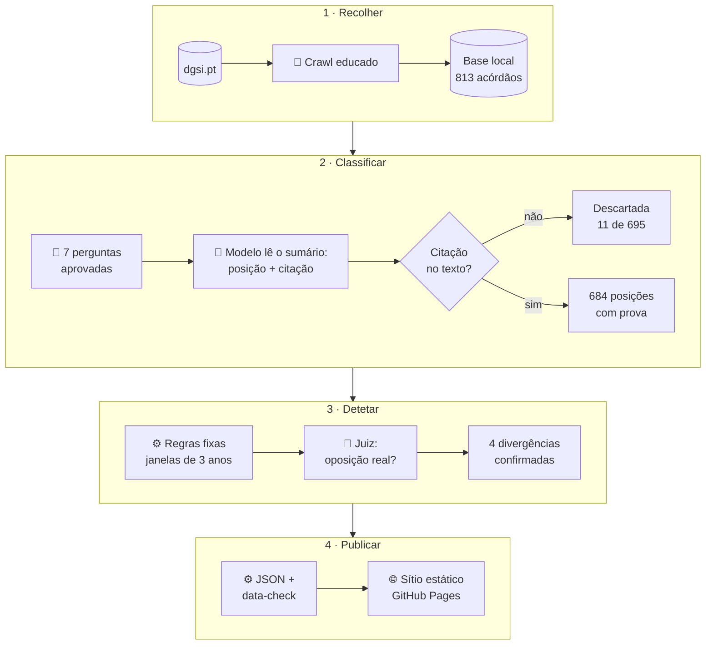
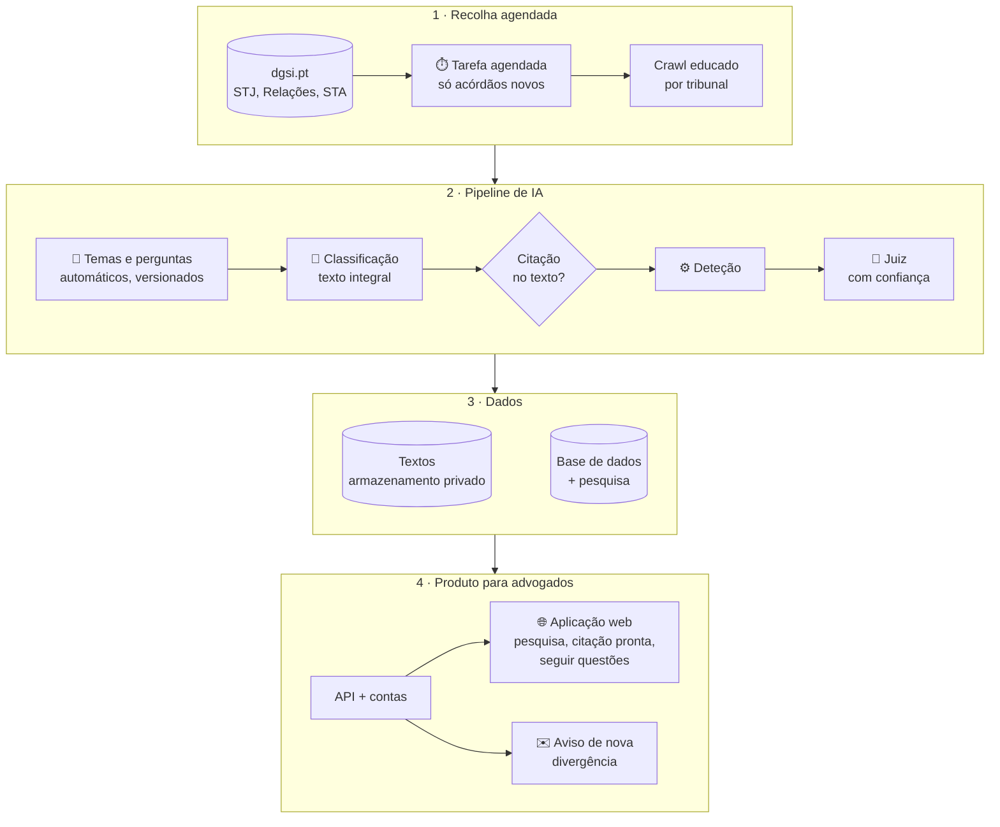
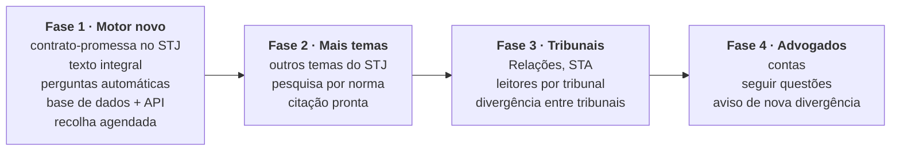

# Arquitetura

Duas imagens: como o MVP foi construído e como deve continuar. Os pormenores estão em [SPEC.md](../SPEC.md) e nas [ADRs](adr/).

## 1. Como o MVP foi construído

👤 corrido por uma pessoa · 🤖 modelo de linguagem · ⚙️ código determinístico

**Três regras seguraram o resultado:**
1. **A citação é a prova.** O que aparece no sítio é texto do próprio acórdão, verificado palavra a palavra; o modelo nunca escreve o que é mostrado ([ADR 0003](adr/0003-quote-grounding.md)).
2. **As pessoas decidem, os modelos propõem.** Crawl, perguntas, limiares e cortes foram decididos por uma pessoa e fixados antes de ver resultados.
3. **Nada de servidor.** Os dados são exportados para JSON e publicados num sítio estático; os textos integrais nunca saem do computador local ([ADR 0001](adr/0001-static-site-github-pages.md)).

## 2. Como deve continuar

Para **advogados e juristas**: mais temas do STJ e outros tribunais, texto integral, atualização automática, pesquisa por questão ou norma, e seguir uma questão.

⏱️ automático · 🤖 modelo de linguagem · ⚙️ código determinístico. Nenhuma pessoa no ciclo: os resultados continuam a ser **sinal para revisão**, com a citação e a ligação ao original.

### Por fases

Cada fase assenta na anterior. A primeira mede o motor novo no tema que o MVP já conhece, para comparar com resultados conhecidos antes de crescer.

| Fase | Pronta quando |
|---|---|
| 1 · Motor novo | No contrato-promessa, as perguntas automáticas e o texto integral reencontram as divergências do MVP (ou explicam por que não), com 0 citações inventadas. |
| 2 · Mais temas | Cada tema novo tem a sua versão de perguntas congelada e a precisão medida numa amostra; a pesquisa encontra uma questão pelo artigo da lei. |
| 3 · Tribunais | Cada tribunal tem leitor próprio com testes sobre páginas guardadas; o crawl educado é cumprido por tribunal. |
| 4 · Advogados | Contas e avisos com dados pessoais mínimos (RGPD) e revisão de segurança feita. |

### MVP e continuação, lado a lado

| | MVP | Continuação |
|---|---|---|
| Cobertura | 1 tema, STJ, 813 acórdãos | vários temas, STJ e outros tribunais |
| O modelo lê | o sumário | o texto integral |
| Perguntas | 7, aprovadas por uma pessoa | automáticas, uma versão congelada por corrida |
| Atualização | manual | agendada, só acórdãos novos |
| Revisão | juiz IA, divulgado | juiz IA com confiança, divulgado |
| Alojamento | sítio estático | API + base de dados + contas |
| Para o advogado | ler | pesquisar, copiar a citação, seguir questões |

**O que se mantém do MVP:** a citação continua a ser a prova (nada é mostrado sem o texto do próprio acórdão e a ligação), o crawl continua educado mesmo quando agendado, e cada corrida usa uma versão fixa das perguntas para que os resultados se possam comparar.

**Riscos a decidir:**
- **Perguntas automáticas** deixam de ser fixadas por uma pessoa antes de classificar: é preciso versioná-las e medir a sua qualidade, ou as divergências podem nascer de perguntas mal formadas.
- **Só IA, para advogados:** um erro do juiz pode chegar a uma peça processual; a confiança e a citação têm de estar sempre à vista.
- **Contas e avisos** trazem dados pessoais (RGPD) e uma superfície de segurança que o sítio estático não tinha.
- **Custo:** ler o texto integral de vários tribunais custa várias vezes mais do que o sumário.
